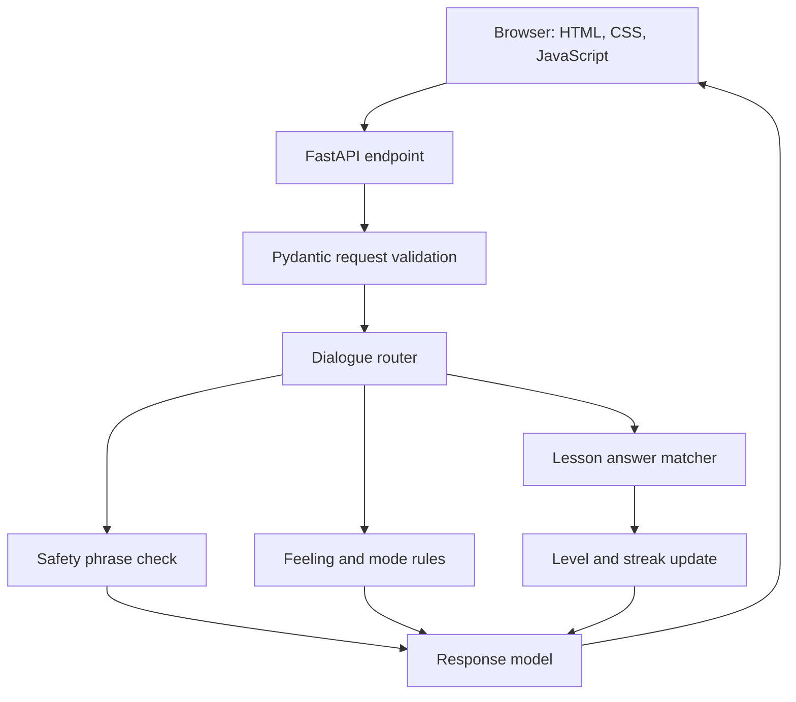

# Architecture

The browser is a thin client. FastAPI validates each message, routes it to a dialogue mode, checks curated lesson answers, and returns updated session progress. No external model or transcript database is used in this version.
